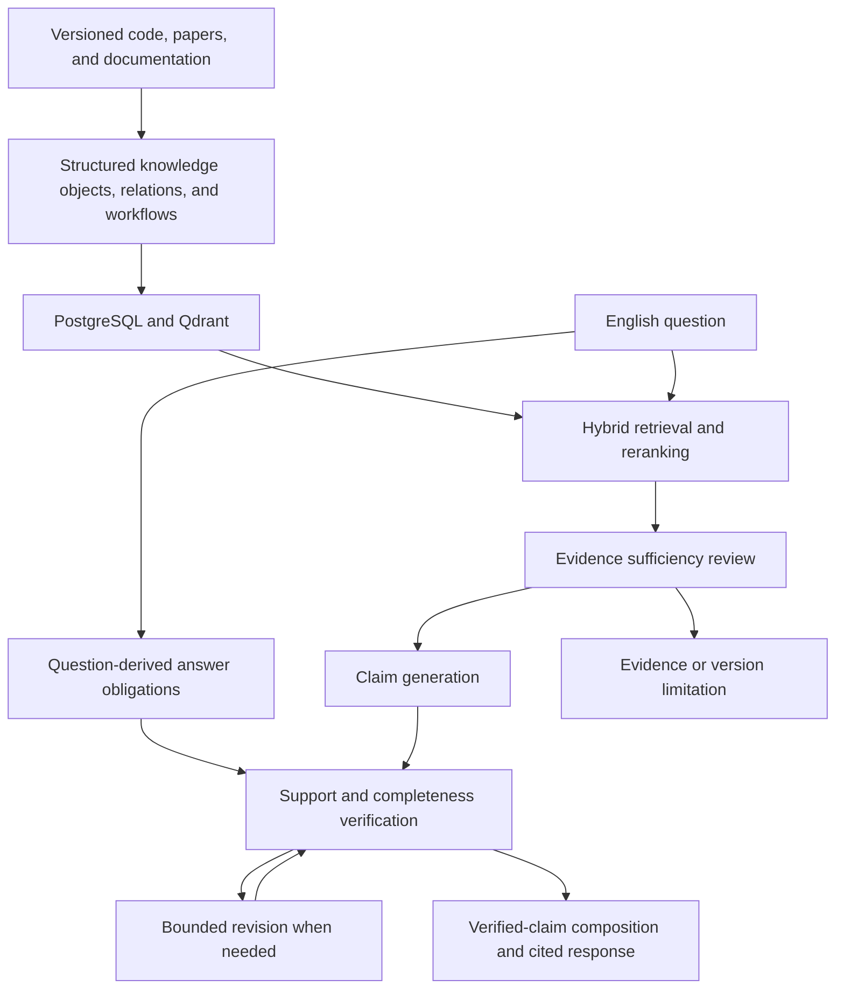

# PANDA Research QA Agent

**An evidence-grounded research assistant for understanding PANDA scientific software across code, papers, and documentation.**

Research software often distributes its explanation across a thesis, a codebase,
configuration files, and operational tutorials. Finding a symbol is only part of
the work: understanding what it means, how it is used, and which software version
it belongs to requires connecting these sources.

PANDA Research QA Agent brings those sources into one question-answering workflow.
It retrieves versioned evidence, generates claims with citations, and checks their
support before presenting an answer. It is designed for researchers and developers
working with PANDA luminosity analysis, simulation, and reconstruction software.

> **Project status:** Local research prototype. The evaluation snapshot below is
> F6-A Attempt 5, which completed its 59-question exposed benchmark but **did not
> pass the pre-release gate**. Phase G development is paused; later changes on
> this branch are not represented by those measurements.

## What you can ask

The agent supports English questions about installation, usage, APIs, algorithm
theory and implementation, data flow, module structure, and troubleshooting.
Typical questions include:

- Where is a documented algorithm implemented, and how does the code relate to its mathematical description?
- What does a class or function do, and where is it used?
- Which configuration and execution steps belong to an analysis workflow?
- What do the locked documentation and source code say about a reported problem?

Answers include references to supporting code, paper passages, or documentation.
When evidence is inadequate or a requested version conflicts with the corpus, the
system can report that limitation. These safeguards do not guarantee complete or
correct answers.

## Knowledge scope

| Source | Role |
| --- | --- |
| **LuminosityFit** | Luminosity-analysis implementation and configuration |
| **PandaRoot** | Simulation, reconstruction, analysis code, and tutorials |
| **RestgasDetermination** | Residual-gas analysis software |
| **Three research theses** — Li, Karavdina, and Pflüger | Scientific context, methods, and mathematical descriptions |
| **PandaRoot Sphinx documentation** — `2023-08-25-dev` snapshot | Installation, operational guidance, and workflows |

Repositories are pinned to commits and documents to snapshots. Answers describe
the indexed versions. The [source manifest](data/manifests/source_manifest.json)
records the exact corpus identities.

## How it works

PANDA uses structured retrieval-augmented generation (RAG) with a bounded QA
workflow. Source structure and provenance remain available throughout answering.



1. **Structure the sources.** Code parsers and document extractors preserve
   symbols, locations, relationships, and workflow steps alongside searchable text.
2. **Retrieve complementary evidence.** Exact-symbol, dense, sparse, workflow,
   and relation-graph retrieval feed rank fusion and reranking. Questions can draw
   on both scientific explanation and implementation evidence.
3. **Answer against explicit obligations.** The question is decomposed into a
   bounded set of requested points. The workflow assesses evidence sufficiency,
   generates claims, and reviews support and coverage, with at most one answer
   revision in the Attempt-5 production path.
4. **Keep support visible.** Deterministic checks validate citation integrity and
   provenance; a separate semantic-verification role reviews claim support.
   A bounded composer works from verified claims, with deterministic rendering as
   a fallback. The external evaluation judge is separate from runtime answering.

| Layer | Main technologies |
| --- | --- |
| Runtime and orchestration | Python 3.12+, Pydantic, LangGraph |
| Source processing | Tree-sitter, Python AST, Docling, PyMuPDF, BeautifulSoup |
| Knowledge storage and search | PostgreSQL 17, Qdrant 1.15, dense embeddings, BM25 |
| Model access | Google Gen AI SDK through Vertex AI |
| Local interfaces | CLI, FastAPI JSON API, Jinja2/HTMX browser UI |

## Measured performance

The reference run is **F6-A Attempt 5**, candidate `f6a-rc5-20260919`, using
`production_answer_obligations_v1`. It evaluated **59 formal-English questions
from the exposed Gold v2.10 benchmark**. All 59 completed after recovery of ten
retryable transport failures.

| Measure | Observed result | Required gate |
| --- | ---: | ---: |
| Gold evidence recall@10 | 97.96% | At least 95% — PASS |
| Final evidence recall | 90.82% | At least 90% — PASS |
| Critical final evidence recall | 91.84% | 100% — **FAIL** |
| Expected answer-status accuracy | 100% | At least 97.5% — PASS |
| Citation integrity | 100% | 100% — PASS |
| Answer-point coverage | 94.92% | At least 90% — PASS |
| Identifier hallucination rate | 4.62% | Below 3% — **FAIL** |
| Critical answer points missed | 4 | Zero — **FAIL** |

These metrics cover evidence retrieval and retention, answer completeness, and
identifier accuracy. Citation integrity measures valid references, not overall
factual correctness. The identifier rate uses the evaluator's identifier
denominator, rather than the number of questions.

The aggregate release score was **0.9492**, but three mandatory gates failed,
so the overall result was **FAIL**. Observed weaknesses included missing critical
evidence, incomplete answers, and invented technical identifiers. Ablation,
novel-question stages, and the composer audit were not reached; the protected
blind release evaluation was not run. This exposed benchmark does not establish
independent generalization or release readiness.

The run used `gemini-3.8-flash` for generation, effective verification, composition,
and the offline judge, with `gemini-embedding-2` embeddings at 3,072 dimensions.
The index held 104,973 points. Total recorded usage, including retryable failed
attempts and evaluation, was **563 model calls / 3,201,331 tokens**. This is a
benchmark-run total, not a per-question runtime price.

The [Attempt-5 report](evaluation/F6_A5_PRERELEASE_VALIDATION_RESULT.md) provides
the full gate table, methodology, usage, and candidate identity. These historical
measurements apply to that candidate; running the current checkout or an older
knowledge bundle does not reproduce the evaluated configuration by itself.

## Run locally

The simplest entry point uses a **compatible prebuilt knowledge bundle**, avoiding
corpus parsing and index rebuilding. You need Python 3.12+, Docker Compose v2,
Google Cloud Application Default Credentials, and Vertex AI access for the
configured models. Query embedding and generation still use Vertex AI after
bundle restore.

From the repository root, in PowerShell:

```powershell
python -m venv .venv
.\.venv\Scripts\Activate.ps1
python -m pip install -e ".[qa]"
Copy-Item .env.example .env
```

Configure `.env` for your Google Cloud project, location, model access, and local
database credentials, and complete ADC authentication. Generation and evaluation-
judge settings are required by the configuration; the judge runs only during
offline evaluation. Embeddings must match the restored index's model and
3,072-dimensional contract.

With a compatible bundle supplied by the maintainer, restore into a fresh local
data environment:

```powershell
$bundlePath = 'D:\panda-bundles\your-compatible-bundle'
panda-qa-kb inspect --bundle $bundlePath
docker compose up -d --wait postgres qdrant
panda-qa-kb restore --bundle $bundlePath --project-root (Get-Location)
panda-qa-kb verify --bundle $bundlePath --project-root (Get-Location)
python -m alembic upgrade head
panda-qa-runtime register-runtime --bundle $bundlePath --project-root (Get-Location)
panda-qa-runtime verify --project-root (Get-Location)
panda-qa-ui --project-root (Get-Location)
```

Before registration, bundle verification may report `runtime_status=not_registered`
and still succeed. After setup, `panda-qa-ui` starts the data services, verifies the
runtime, and opens `http://127.0.0.1:8000/ui`. Press `Ctrl+C` to stop the UI server;
the data services remain running.

The same QA service is available through `panda-qa ask "How is event_poca used?"`
and the `panda-qa-api` JSON endpoint `POST /v1/qa`. The UI includes diagnostic views
and JSON download.

The [bundle first-run guide](docs/NEW_USER_BUNDLE_GUIDE.md) covers acquisition,
Windows/macOS/Linux setup, authentication, and troubleshooting. The older public
v2.0.0 bundle documented there is not the Attempt-5 evaluation index. See the
[bundle reference](docs/KNOWLEDGE_BUNDLE_PROTOTYPE.md) for compatibility and restore
preconditions.

## Scope and limitations

- **Research assistance:** Expert review remains necessary, especially for
  scientific conclusions, exact API names, and procedural completeness.
- **Fixed corpus and English questions:** Coverage is limited to the indexed
  projects and snapshots. Multilingual QA and arbitrary repository uploads are
  outside the supported scope.
- **Read-only, single-turn interaction:** The agent explains software; it does
  not edit code, execute analysis workflows, or maintain conversational memory.
- **Local prototype deployment:** The UI/API bind to loopback. Shared accounts,
  remote hosting, and public deployment are outside this prototype's scope.

## Further reading

- [Current evaluation and product state](docs/EVALUATION_STATUS.md)
- [Evaluation policy](docs/EVALUATION_POLICY.md)
- [Phase-F closeout and interpretation of release evidence](evaluation/PHASE_F_CLOSEOUT.md)
- [Architecture and implementation history](QA_AGENT.md)

Phase G development is paused. Existing code and historical results are preserved;
resuming development requires a new user instruction.
